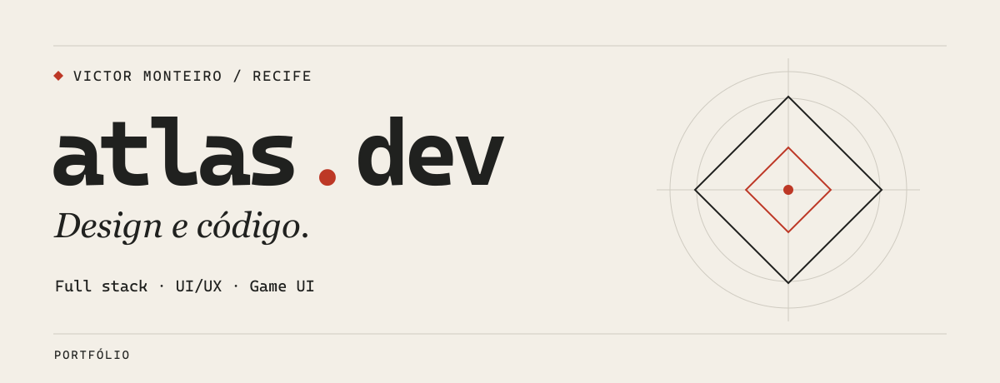
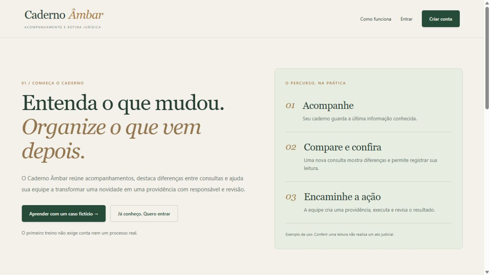

# atlas.dev — Victor Monteiro

[](https://atlasaquidev.vercel.app/)

Portfólio pessoal de UI/UX, desenvolvimento web e Game UI, publicado em https://atlasaquidev.vercel.app/.

## Executar e verificar

Requisitos: Node.js 20+ e npm (produção Vercel: Node 24).

```bash
npm ci
npm run dev
npm run lint
npx tsc --noEmit
npm run build
npm start
```

## Páginas e tecnologias

- `/`: apresentação animada, trabalhos e atividade pública no GitHub.
- `/sobre`: trajetória e tecnologias/módulos utilizados neste portfólio.
- `/formacao`: formação acadêmica.
- `/experiencia`: residências, colaboração, entregas e documentação.
- `/projetos`: seis estudos de caso, com contribuição, imagens, créditos e links.
- `/projetos/[slug]`: apresentação individual de cada trabalho.
- `/api/github`: integração real com a API pública do GitHub, sem token.

Next.js 14 (App Router), React 18, TypeScript, CSS, Tailwind CSS, Framer Motion, Web Animations API, Lucide e React Icons. Fontes locais e imagens otimizadas pelo Next.js. Menu responsivo, foco visível, galerias por teclado e respeito a movimento reduzido.

A rota GitHub consulta os repositórios públicos de `atlasaqui`, limita a três resultados próprios e retorna somente dados públicos. Há timeout, cache de consulta e estados de carregamento, vazio e erro com nova tentativa. Nenhuma credencial é necessária. A disponibilidade depende do GitHub e de seus limites públicos.

## Projetos atualizados

- **ISAC Brechó:** entrega acadêmica concluída, React/TypeScript, API Java/Spring Boot, PostgreSQL e Android via Capacitor. APK 0.1.1-sandbox disponível no case. Pagamento Asaas em ambiente de testes; operação comercial e Mercado Livre não são apresentados como homologados.
- **Caderno Âmbar:** versão de estudo concluída e demonstração independente em https://caderno-ambar.vercel.app/. O case distingue a demonstração pública com casos fictícios do piloto Python/FastAPI/SQLite e de suas dependências externas. Requests, Beautiful Soup e Playwright são explicados conforme seus papéis.
- **Atlanslate:** Android experimental em desenvolvimento. Galeria distingue o protótipo visual mais recente no Figma da implementação Android anterior. Não há promessa de versão final ou download público.
- Big Fight Small Robots, Rastros e Bode do Nô preservam seus cases e créditos.

## Estrutura

`app/` contém rotas e estilos. `components/editorial/` reúne a interface e a API visual. `lib/cases.ts` centraliza os cases. `public/ASSETS/` reúne materiais reais dos projetos; `public/downloads/` contém o APK demonstrativo.

## Publicação

Repositório: https://github.com/atlasaqui/Atlas.Dev-Website

Produção: branch `main`, projeto Vercel `atlasaqui.dev`, domínio https://atlasaquidev.vercel.app/. O ISAC e o Caderno Âmbar têm publicações próprias; este repositório apresenta seus cases.

## Materiais e créditos

As capturas ISAC e Caderno Âmbar foram atualizadas a partir de suas aplicações em 18/11/2026. Os materiais Atlanslate vêm dos estudos reais do projeto: Android experimental de 15/11 e direção visual Figma de 16/11. Marcas, autoria colaborativa e contexto estão identificados nos cases. Materiais anteriores e licenças de fontes foram preservados.

APK de homologação: `public/downloads/ISAC-Brecho-0.1.1-sandbox.apk`.
SHA-256: `394B214593C329A109C48EBF93AEB404C2BA9BA97CDC25371285CD161BDEDDBF`.
O APK utiliza pagamentos de teste e não inclui contas, senhas ou chaves de API neste portfólio.


## Um passeio pelo portfólio

O menu do topo liga as cinco páginas do currículo. Na Home, a frase de abertura animada apresenta o trabalho e as prévias levam aos estudos de caso. As páginas internas detalham minhas ferramentas, minha formação e o que fiz nos projetos em equipe.

| Página | O que encontrar |
| --- | --- |
| [Home](https://atlasaquidev.vercel.app/) | Apresentação, prévias interativas, ferramentas e atividade no GitHub |
| [Sobre](https://atlasaquidev.vercel.app/sobre) | Perfil, ferramentas por área e tecnologias do próprio portfólio |
| [Formação](https://atlasaquidev.vercel.app/formacao) | UNICAP, UNIAESO e acesso ao diploma de Design de Animação |
| [Experiência](https://atlasaquidev.vercel.app/experiencia) | Participação nos projetos, trabalho em equipe e documentação |
| [Projetos](https://atlasaquidev.vercel.app/projetos) | Estudos de caso com telas, créditos e links |

As prévias abaixo são os mesmos materiais usados nos cases do site.

| ISAC Brechó · aplicativo Android | Caderno Âmbar · automação | Atlanslate · protótipo |
| :---: | :---: | :---: |
| [](https://atlasaquidev.vercel.app/projetos/bazar-solidario) | [](https://atlasaquidev.vercel.app/projetos/caderno-ambar) | [](https://atlasaquidev.vercel.app/projetos/atlanslate) |

## Como chegam as atualizações do GitHub

~~~mermaid
flowchart LR
    A["Home e Sobre"] --> B["GET /api/github"]
    B --> C["GitHub REST API"]
    C --> B
    B --> D["Até três repositórios públicos"]
~~~

A rota do Next.js chama GET /users/atlasaqui/repos, ordenado pela atualização, e retorna nome, descrição, linguagem, link e data. Home e Sobre exibem os resultados e oferecem nova tentativa em caso de falha. A Web Animations API também é utilizada no navegador para animar as letras da Home. As integrações dos projetos apresentados são descritas nos respectivos cases.
